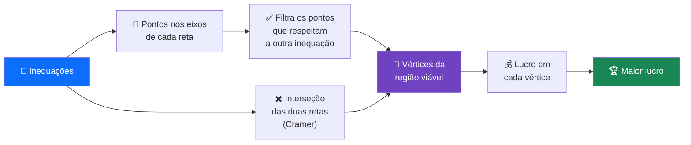
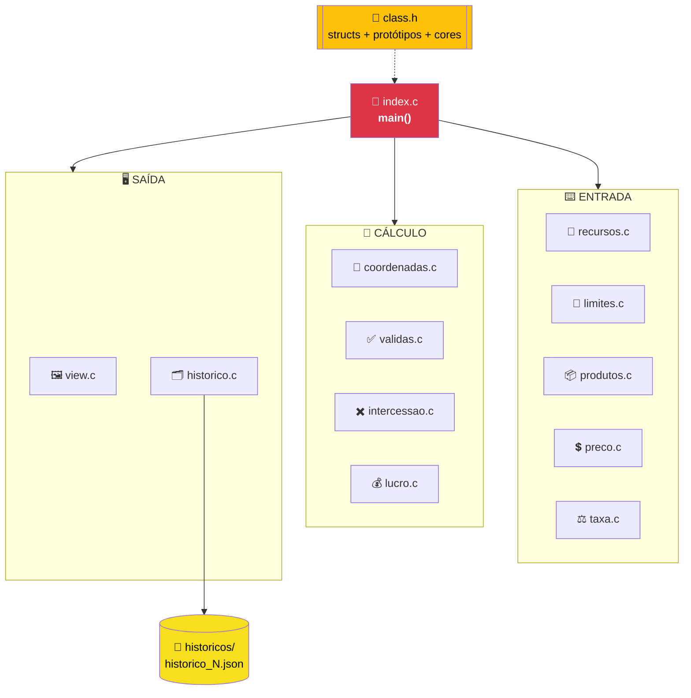
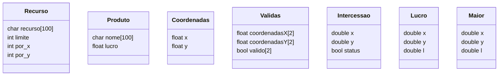
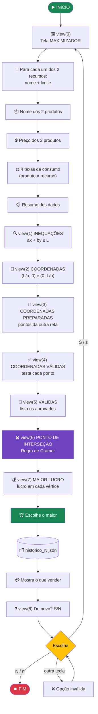
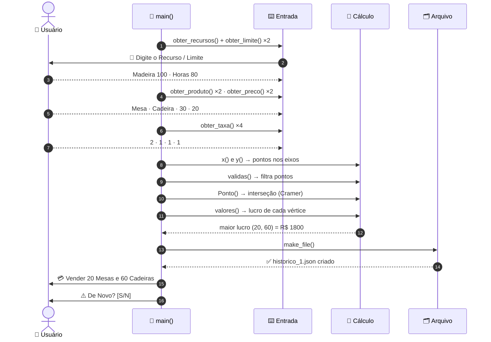
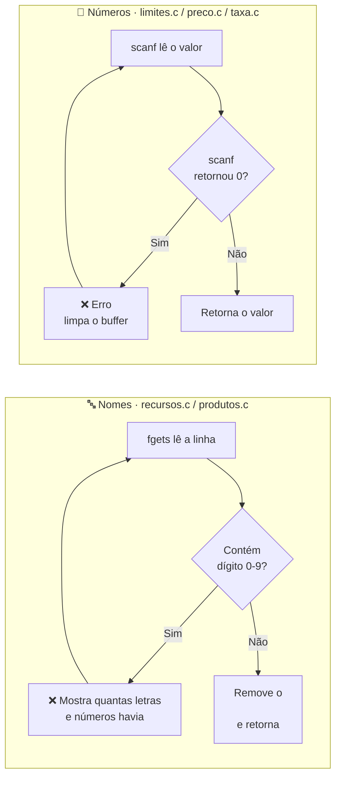
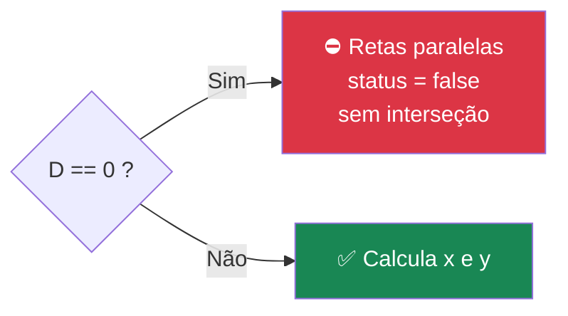
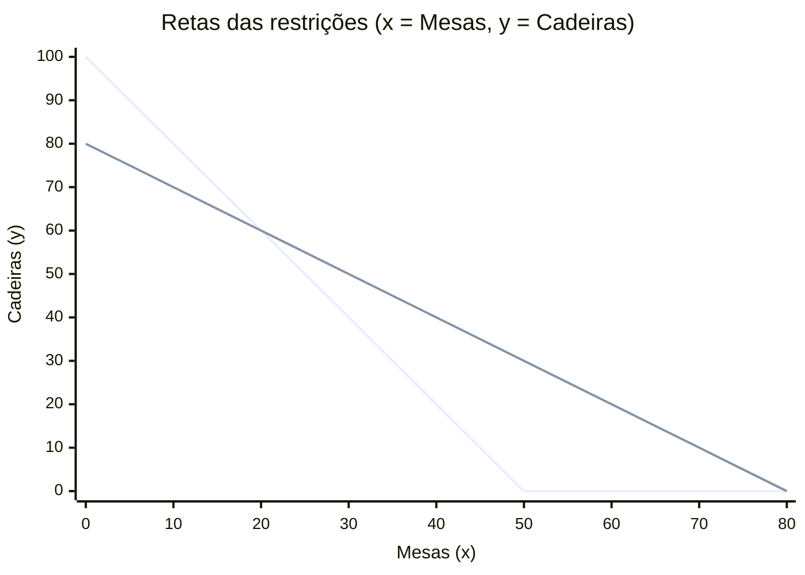
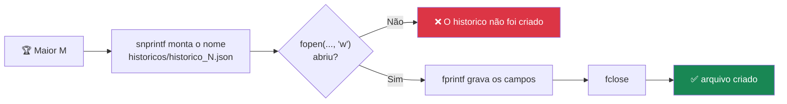

<div align="center">

# 📈 Maximizador de Lucro: Inequações e Programação Linear em C

**Programa de terminal que descobre quanto produzir de cada produto para ter o maior lucro possível, respeitando os limites dos recursos disponíveis**


```
  ╔══════════════════════════════════════════╗
  ║        ▓▓▓  MAXIMIZADOR  ▓▓▓             ║
  ║   Programacao Linear - Otimizacao        ║
  ║   de Lucro com Recursos Limitados        ║
  ╚══════════════════════════════════════════╝

  💳 Deve se vender:
   🏷️  20.00 de Mesa
   🏷️  60.00 de Cadeira
   💰 Lucro (Maior): 1800.00
```

</div>

---

## 📑 Sumário

1. [Visão geral](#-visão-geral)
2. [O problema matemático](#-o-problema-matemático)
3. [Estrutura do projeto](#-estrutura-do-projeto)
4. [Arquitetura dos módulos](#-arquitetura-dos-módulos)
5. [Estruturas de dados](#-estruturas-de-dados)
6. [Como compilar e executar](#-como-compilar-e-executar)
7. [Fluxo de funcionamento](#-fluxo-de-funcionamento)
8. [As 9 etapas em detalhe](#-as-9-etapas-em-detalhe)
9. [Exemplo completo resolvido](#-exemplo-completo-resolvido)
10. [Histórico em JSON](#-histórico-em-json)
11. [Pontos de atenção](#-pontos-de-atenção)
12. [Análise de complexidade](#-análise-de-complexidade)
13. [Possíveis melhorias](#-possíveis-melhorias)

---

## 🎯 Visão geral

Imagine uma marcenaria que fabrica **mesas** e **cadeiras**. Cada peça gasta **madeira** e **horas de trabalho**, e existe uma quantidade máxima de cada recurso. Quantas mesas e quantas cadeiras ela deve fabricar para **lucrar o máximo**?

Esse é um problema clássico de **Programação Linear**, e este programa resolve exatamente isso para **2 produtos** e **2 recursos**, usando o **método gráfico** (análise dos vértices da região viável).

| Item | Descrição |
|---|---|
| **Entrada** | Nomes de 2 recursos e seus limites, nomes de 2 produtos, preço de cada produto e quanto cada produto gasta de cada recurso |
| **Processamento** | Monta as inequações, calcula os pontos nos eixos, valida esses pontos, encontra a interseção das retas (Regra de Cramer) e calcula o lucro em cada vértice |
| **Saída** | A combinação de produtos que gera o **maior lucro**, mostrada na tela e salva em um arquivo `.json` |
| **Repetição** | Ao final, o usuário escolhe se quer resolver outro problema (`S`/`N`) |

---

## 📐 O problema matemático

Chamando o **produto 1** de `x` e o **produto 2** de `y`:

```
  ┌───────────────────────────────────────────────────────────────┐
  │  🎯 MAXIMIZAR    Lucro = preço₁ · x  +  preço₂ · y             │
  │                                                               │
  │  🚧 SUJEITO A    taxa₁ₓ · x  +  taxa₁ᵧ · y  ≤  limite₁          │
  │                  taxa₂ₓ · x  +  taxa₂ᵧ · y  ≤  limite₂          │
  │                  x ≥ 0 ,  y ≥ 0                               │
  └───────────────────────────────────────────────────────────────┘
```

### 🔑 A ideia central: o lucro máximo está sempre em um vértice

As inequações formam uma **região viável** no plano (as combinações de produção possíveis). O **Teorema Fundamental da Programação Linear** garante que o lucro máximo está em um dos **cantos (vértices)** dessa região. Por isso o programa não testa todos os pontos: testa só os vértices.



---

## 📁 Estrutura do projeto

```
Inequacoes/
├── 📘 README.md
├── 📝 runner.txt          → comando de compilação e execução
├── 🧩 class.h             → structs, cores ANSI e protótipos de todas as funções
│
├── 🚪 index.c             → main(): orquestra todas as etapas
│
├── ── ENTRADA DE DADOS ──
├── 🧱 recursos.c          → obter_recursos()  · lê e valida o nome do recurso
├── 🚧 limites.c           → obter_limite()    · lê o limite do recurso
├── 📦 produtos.c          → obter_produto()   · lê e valida o nome do produto
├── 💲 preco.c             → obter_preco()     · lê o preço unitário
├── ⚖️ taxa.c              → obter_taxa()      · lê quanto cada produto gasta
│
├── ── CÁLCULOS ──
├── 📍 coordenadas.c       → x() e y()         · pontos onde a reta corta os eixos
├── ✅ validas.c           → validas()         · testa se um ponto respeita a inequação
├── ✖️ intercessao.c       → Ponto()           · interseção das retas (Regra de Cramer)
├── 💰 lucro.c             → valores()         · lucro de um ponto (x, y)
│
├── ── SAÍDA ──
├── 🖼️ view.c              → view()            · cabeçalhos visuais de cada etapa
├── 🗂️ historico.c         → make_file()       · grava o resultado em JSON
├── 🖨️ imprimir.c          → imprimir()        · texto "Válida/Inválida" (não utilizada)
│
├── ⚙️ index.exe           → executável gerado
└── 📂 historicos/
    ├── historico_1.json
    ├── historico_2.json
    └── historico_3.json
```

---

## 🧭 Arquitetura dos módulos

O `index.c` é o maestro: ele chama cada módulo na ordem certa. Todos os módulos compartilham as definições do `class.h`.



---

## 🧱 Estruturas de dados

Definidas no `class.h`:



| Struct | Papel | Instâncias no `main` |
|---|---|---|
| `Recurso` | Um recurso (ex.: Madeira): limite e quanto cada produto consome | `R[2]` |
| `Produto` | Um produto (ex.: Mesa) e seu preço de venda (`lucro`) | `P[2]` |
| `Coordenadas` | Onde a reta de um recurso corta o eixo X e o eixo Y | `C[4]` (usa 2) |
| `Validas` | Pontos da **outra** reta que respeitam esta inequação | `Va[2]` |
| `Intercessao` | Ponto onde as duas retas se cruzam, e se ele existe | `I` |
| `Lucro` | Um ponto candidato e o lucro calculado nele | `L[6]` |
| `Maior` | O ponto vencedor | `M` |

### 🎨 Cores ANSI (definidas mas reservadas para uso futuro)

```c
#define VERMELHO "\x1b[31m"
#define VERDE    "\x1b[32m"
#define AMARELO  "\x1b[33m"
#define AZUL     "\x1b[34m"
#define RESET    "\x1b[0m"
```

---

## 🚀 Como compilar e executar

### Pré-requisitos

- **GCC** no Windows (via [MinGW-w64](https://www.mingw-w64.org/) ou [MSYS2](https://www.msys2.org/))
- Terminal **PowerShell**
- A pasta **`historicos/`** precisa existir ao lado do executável (veja os [pontos de atenção](#-pontos-de-atenção))

### Comando (o mesmo do `runner.txt`)

```powershell
clear; chcp 65001; gcc.exe index.c limites.c produtos.c preco.c intercessao.c imprimir.c validas.c coordenadas.c historico.c recursos.c lucro.c taxa.c view.c -o index.exe; .\index.exe;
```


> 💡 Os 13 arquivos `.c` são compilados juntos em um único executável. O `class.h` não entra na lista porque é incluído automaticamente pelos `#include "class.h"`.

---

## 🔄 Fluxo de funcionamento

### Fluxograma geral



### Interação usuário ↔ programa



---

## 🔬 As 9 etapas em detalhe

### 1️⃣ Entrada de dados com validação

Cada leitura tem seu próprio módulo e **repete a pergunta até receber um valor válido**.



| Função | Lê | Validação | Tipo de retorno |
|---|---|---|---|
| `obter_recursos()` | Nome do recurso | Rejeita qualquer dígito | `char*` (buffer `static`) |
| `obter_limite(recurso)` | Limite máximo | Precisa ser numérico | `float` |
| `obter_produto()` | Nome do produto | Rejeita qualquer dígito | `char*` (buffer `static`) |
| `obter_preco(produto)` | Preço por unidade | Precisa ser numérico | `float` |
| `obter_taxa(produto, recurso)` | Consumo do recurso por unidade | Precisa ser inteiro | `int` |

> 🔑 **Por que `static`?** As funções devolvem um ponteiro para um vetor criado dentro delas. Sem `static`, esse vetor deixaria de existir quando a função terminasse. Por isso o `main` copia o texto na hora com `strcpy`, antes da próxima chamada sobrescrever o mesmo buffer.

#### Ordem em que as perguntas aparecem

```
  ┌────┬──────────────────────────────────────────────┬──────────────┐
  │ #  │ Pergunta                                     │ Vai para     │
  ├────┼──────────────────────────────────────────────┼──────────────┤
  │ 1  │ 📌 Digite o Recurso                          │ R[0].recurso │
  │ 2  │ 📌 Digite o Limite de <recurso 1>            │ R[0].limite  │
  │ 3  │ 📌 Digite o Recurso                          │ R[1].recurso │
  │ 4  │ 📌 Digite o Limite de <recurso 2>            │ R[1].limite  │
  │ 5  │ 📌 Digite o Produto                          │ P[0].nome →x │
  │ 6  │ 📌 Digite o Produto                          │ P[1].nome →y │
  │ 7  │ 📌 Preço por Unidade do(a) <produto 1>       │ P[0].lucro   │
  │ 8  │ 📌 Preço por Unidade do(a) <produto 2>       │ P[1].lucro   │
  │ 9  │ 📌 Quanto cada <produto 1> gasta de <rec. 1> │ R[0].por_x   │
  │ 10 │ 📌 Quanto cada <produto 2> gasta de <rec. 1> │ R[0].por_y   │
  │ 11 │ 📌 Quanto cada <produto 1> gasta de <rec. 2> │ R[1].por_x   │
  │ 12 │ 📌 Quanto cada <produto 2> gasta de <rec. 2> │ R[1].por_y   │
  └────┴──────────────────────────────────────────────┴──────────────┘
```

---

### 2️⃣ Montagem das inequações · `view(1)`

Cada recurso vira uma inequação:

```
  R[i].por_x · x  +  R[i].por_y · y  ≤  R[i].limite

  🔍 2x + 1y ≤ 100      ← Madeira
  🔍 1x + 1y ≤ 80       ← Horas
```

---

### 3️⃣ Pontos onde cada reta corta os eixos · `view(2)` · `coordenadas.c`

Transformando a inequação em igualdade (`ax + by = L`), a reta corta os eixos em:

```
  Zerando y  →  a·x = L  →  x = L / a      →  ponto (L/a , 0)
  Zerando x  →  b·y = L  →  y = L / b      →  ponto (0 , L/b)
```

```c
float x(float x, float y, float limite) { return limite / x; }  // L / a
float y(float x, float y, float limite) { return limite / y; }  // L / b
```

| Inequação | Corta o eixo X | Corta o eixo Y |
|---|:-:|:-:|
| `2x + 1y ≤ 100` | `100/2 = 50` → **(50, 0)** | `100/1 = 100` → **(0, 100)** |
| `1x + 1y ≤ 80` | `80/1 = 80` → **(80, 0)** | `80/1 = 80` → **(0, 80)** |

---

### 4️⃣ Cruzamento dos pontos · `view(3)`

Um ponto só é vértice se respeitar **as duas** inequações. Por isso cada inequação recebe os pontos da **outra** reta para testar. O índice da outra é obtido com o operador `%`:

```c
int outro = (i + 1) % tamanho;   // tamanho = 2
```

```
   i = 0  →  (0 + 1) % 2 = 1   →  inequação 0 testa os pontos da reta 1
   i = 1  →  (1 + 1) % 2 = 0   →  inequação 1 testa os pontos da reta 0

        ┌─────────────────┐            ┌─────────────────┐
        │  Inequação 0    │ ◀───────── │  Pontos reta 1  │
        │  2x + y ≤ 100   │            │ (80,0) (0,80)   │
        └─────────────────┘            └─────────────────┘
        ┌─────────────────┐            ┌─────────────────┐
        │  Inequação 1    │ ◀───────── │  Pontos reta 0  │
        │  x + y ≤ 80     │            │ (50,0) (0,100)  │
        └─────────────────┘            └─────────────────┘
```

> 💡 Os pontos da própria reta sempre satisfazem a própria inequação (estão exatamente em cima dela), então só faz sentido testá-los contra a outra.

---

### 5️⃣ Validação dos pontos · `view(4)` e `view(5)` · `validas.c`

```c
float resultado = (recursos_x * x) + (recursos_y * y);
if (resultado > limite)  → ❌ return false
else                     → ✅ return true
```

| Inequação | Ponto testado | Conta | Resultado | |
|---|:-:|:--|:-:|:-:|
| `2x + y ≤ 100` | (80, 0) | `2·80 + 1·0 = 160` | 160 > 100 | ❌ |
| `2x + y ≤ 100` | (0, 80) | `2·0 + 1·80 = 80` | 80 ≤ 100 | ✅ |
| `x + y ≤ 80` | (50, 0) | `1·50 + 1·0 = 50` | 50 ≤ 80 | ✅ |
| `x + y ≤ 80` | (0, 100) | `1·0 + 1·100 = 100` | 100 > 80 | ❌ |

Os aprovados são guardados em `Va[i]` com `valido[a] = true` e listados na tela **VALIDAS**:

```
(x,y): (0.0,80.0)
(x,y): (50.0,0.0)
```

---

### 6️⃣ Interseção das retas · `view(6)` · `intercessao.c`

O ponto onde as duas retas se cruzam é calculado pela **Regra de Cramer**, resolvendo o sistema:

```
  ⎧ a₁·x + b₁·y = L₁          ⎧ 2x + 1y = 100
  ⎨                     →     ⎨
  ⎩ a₂·x + b₂·y = L₂          ⎩ 1x + 1y = 80
```

#### Passo 1: Determinante principal (D)

```
        │ a₁   b₁ │     │ 2   1 │
  D  =  │         │  =  │       │  =  (2 · 1) − (1 · 1)  =  1
        │ a₂   b₂ │     │ 1   1 │
            ╲ ╱
         multiplica em X e subtrai
```



#### Passo 2: Substituir a coluna de x pelos limites (Dₓ)

```
        │ L₁   b₁ │     │ 100   1 │
  Dₓ =  │         │  =  │         │  =  (100 · 1) − (80 · 1)  =  20      →   x = Dₓ / D = 20
        │ L₂   b₂ │     │  80   1 │
```

#### Passo 3: Substituir a coluna de y pelos limites (Dᵧ)

```
        │ a₁   L₁ │     │ 2   100 │
  Dᵧ =  │         │  =  │         │  =  (2 · 80) − (100 · 1)  =  60      →   y = Dᵧ / D = 60
        │ a₂   L₂ │     │ 1    80 │
```

```c
double determinante = (recursox1 * recursoy2) - (recursox2 * recursoy1);
double x = ((limite1 * recursoy2) - (limite2 * recursoy1)) / determinante;
double y = ((limite2 * recursox1) - (limite1 * recursox2)) / determinante;
```

✅ **Interseção: (20, 60)**. Como `x ≥ 0` e `y ≥ 0`, o programa mostra `X: 20.00 , Y: 60.00`. Se fosse negativa, mostraria `Não possui Intercessão`.

---

### 7️⃣ Lucro em cada vértice · `view(7)` · `lucro.c`

```c
Lucro = preco_x · x  +  preco_y · y
```

| Vértice | Origem | Conta | Lucro |
|:-:|---|:--|--:|
| (0, 80) | Ponto válido | `30·0 + 20·80` | R$ 1.600,00 |
| (50, 0) | Ponto válido | `30·50 + 20·0` | R$ 1.500,00 |
| **(20, 60)** | **Interseção** | `30·20 + 20·60` | **R$ 1.800,00** 🏆 |

```
  (0, 80)   │ ███████████████████████████████████            R$ 1600
  (50, 0)   │ █████████████████████████████████              R$ 1500
  (20, 60)  │ ████████████████████████████████████████  🏆   R$ 1800
            └──────────────────────────────────────────
```

### 8️⃣ Escolha do maior

```c
Maior M = {0};
for (...) if (L[i].l > M.l) M = L[i];   // varredura simples pelo maior valor
```

### 9️⃣ Gravação e repetição

O resultado é gravado em `historicos/historico_N.json` e o programa pergunta se o usuário quer resolver outro problema. A cada repetição, `N` aumenta (`historico_1`, `historico_2`, ...).

---

## 🧪 Exemplo completo resolvido

### O cenário

> Uma marcenaria tem **100 unidades de madeira** e **80 horas de trabalho**.
> Uma **mesa** gasta 2 de madeira e 1 hora, e é vendida por **R$ 30**.
> Uma **cadeira** gasta 1 de madeira e 1 hora, e é vendida por **R$ 20**.

| | 🪑 Mesa (x) | 💺 Cadeira (y) | 🚧 Limite |
|---|:-:|:-:|:-:|
| 🪵 Madeira | 2 | 1 | 100 |
| ⏱️ Horas | 1 | 1 | 80 |
| 💲 Preço | R$ 30 | R$ 20 | — |

### A região viável no gráfico

```
   y (Cadeira)
 100 ┤▓
     │ ▓
     │  ▓                          ▓▓  2x + y = 100  (Madeira)
     │   ▓                         ▒▒  x + y = 80    (Horas)
     │    ▓                        ░░  região viável
  80 ┤A▒   ▓
     │░░▒   ▓                      A = (0, 80)    → R$ 1600
     │░░░▒▒▒ ▓                     B = (20, 60)   → R$ 1800 🏆
     │░░░░░░▒ ▓                    C = (50, 0)    → R$ 1500
     │░░░░░░░▒▒▒                   O = (0, 0)     → R$ 0
  60 ┤░░░░░░░░░░B
     │░░░░░░░░░░░▒▒▒
     │░░░░░░░░░░░░▓ ▒
     │░░░░░░░░░░░░░▓ ▒▒▒
     │░░░░░░░░░░░░░░▓   ▒
  40 ┤░░░░░░░░░░░░░░░▓   ▒▒▒
     │░░░░░░░░░░░░░░░░▓     ▒
     │░░░░░░░░░░░░░░░░░▓     ▒▒▒
     │░░░░░░░░░░░░░░░░░░▓       ▒
     │░░░░░░░░░░░░░░░░░░░▓       ▒▒▒
  20 ┤░░░░░░░░░░░░░░░░░░░░▓         ▒
     │░░░░░░░░░░░░░░░░░░░░░▓         ▒▒▒
     │░░░░░░░░░░░░░░░░░░░░░░▓           ▒
     │░░░░░░░░░░░░░░░░░░░░░░░▓           ▒▒▒
   0 ┤O░░░░░░░░░░░░░░░░░░░░░░░C             ▒▒
     └┬─────────┬─────────┬─────────┬─────────┬──  x (Mesa)
      0        20        40        60        80
```

### O mesmo gráfico em Mermaid



> As duas retas se cruzam em **x = 20, y = 60**, o vértice B, que é a resposta ótima.

### Saída real do programa (trechos)

```console
🔍 2x + 1y ≤ 100
🔍 1x + 1y ≤ 80

  ╔═══════════════════════════════════════════════╗
  ║              ▓▓▓  COORDENADAS  ▓▓▓            ║
  ╚═══════════════════════════════════════════════╝
🔍 2x + 1y ≤ 100
Coordenada (x,y): (50.0,0)
Coordenada (x,y): (0,100.0)

🔍 1x + 1y ≤ 80
Coordenada (x,y): (80.0,0)
Coordenada (x,y): (0,80.0)

  ╔═══════════════════════════════════════════════════════╗
  ║              ▓▓▓  COORDENADAS VALIDAS  ▓▓▓            ║
  ╚═══════════════════════════════════════════════════════╝
2(80.0) + 1(0.0) ≤ 160.0 | ❌
2(0.0) + 1(80.0) ≤ 80.0 | ✅
1(50.0) + 1(0.0) ≤ 50.0 | ✅
1(0.0) + 1(100.0) ≤ 100.0 | ❌

  ╔═══════════════════════════════════════════════════════════════════════╗
  ║                ▓▓▓      PONTO DE INTERCESSÃO       ▓▓▓                ║
  ╚═══════════════════════════════════════════════════════════════════════╝
X: 20.00 , Y: 60.00

  ╔═══════════════════════════════════════════════════════════════════════╗
  ║                ▓▓▓           MAIOR LUCRO           ▓▓▓                ║
  ╚═══════════════════════════════════════════════════════════════════════╝
(0.00,80.00) -> R$ 1600.00
(50.00,0.00) -> R$ 1500.00
(0.00,0.00) -> R$ 0.00
(20.00,60.00) -> R$ 1800.00

✅ arquivo criado com sucesso e acessavél na pasta [historicos/]
💳 Deve se vender:
 🏷️  20.00 de Mesa
 🏷️  60.00 de Cadeira
 💰 Lucro (Maior): 1800.00
```

---

## 🗂️ Histórico em JSON

Cada execução gera um arquivo em `historicos/` com o resultado ótimo:



```json
{
   "Mesa": "20.00",
   "Cadeira": "60.00",
   "lucro": "1800.00"
}
```

Históricos já incluídos no projeto:

| Arquivo | Produto 1 | Produto 2 | Lucro |
|---|---|---|--:|
| `historico_1.json` | Camisetas: 0.00 | Calças: 20.00 | 300.00 |
| `historico_2.json` | Sabonete: 4.29 | Vela: 3.43 | 57.43 |
| `historico_3.json` | Pão: 20.00 | Biscoito: 0.00 | 60.00 |

---

## 🚨 Pontos de atenção

Encontrados compilando e executando o código com cenários de teste.

| # | Situação | Onde | Efeito |
|:-:|---|---|---|
| 1 | **Interseção negativa entra no cálculo do lucro** | `index.c` · etapa 7 | Pode recomendar uma **quantidade negativa** como resposta (veja abaixo) |
| 2 | **Posição vazia no vetor de lucros** | `index.c` · `L[total + 1]` | A interseção é gravada uma posição à frente, deixando `L[total]` sem valor (aparece como `(0.00,0.00)` ou lixo de memória) |
| 3 | Validação impressa duas vezes | `index.c` · etapa 5 | Quando o ponto é válido, `validas()` é chamada de novo dentro do `if`, repetindo a mensagem |
| 4 | Pasta `historicos/` precisa existir | `historico.c` | Sem a pasta, o `fopen` falha e o histórico não é gravado |
| 5 | Histórico sobrescrito a cada execução | `historico.c` | O contador reinicia em 1 sempre que o programa abre |
| 6 | Taxa igual a 0 | `coordenadas.c` | Divisão por zero em `limite / taxa` |
| 7 | Limite lido como `float`, guardado como `int` | `limites.c` → `Recurso.limite` | Casas decimais são descartadas (ex.: `99.9` vira `99`) |
| 8 | Nome com número, após o erro | `recursos.c` / `produtos.c` | O `while(getchar())` espera uma linha extra, que é descartada |
| 9 | Resumo pareia recurso *i* com produto *i* | `index.c` · resumo | Apenas visual: o bloco de "Madeira" mostra o preço da "Mesa", e o de "Horas", o da "Cadeira" |

### 🔴 Demonstração do ponto 1

Cenário: Madeira `10x + 6y ≤ 120`, Horas `4x + 2y ≤ 50`, Mesa R$ 20, Cadeira R$ 1.

```console
Não possui Intercessão

(12.00,0.00) -> R$ 240.00
(0.00,20.00) -> R$ 20.00
(0.00,0.00) -> R$ 0.00
(15.00,-5.00) -> R$ 295.00     ← interseção fora da região, mas entrou na disputa

💳 Deve se vender:
 🏷️  15.00 de Mesa
 🏷️  -5.00 de Cadeira          ← resposta impossível
 💰 Lucro (Maior): 295.00
```

A resposta correta seria **(12, 0) com lucro de R$ 240**. A correção é simples: só adicionar a interseção quando ela for válida.

```c
// antes
L[total + 1] = valores(P[0].lucro, P[1].lucro, I.x, I.y);
total = total + 1;
for (int i = 0; i < total + 1; i++) ...

// depois
if (I.status && I.x >= 0 && I.y >= 0) {
    L[total] = valores(P[0].lucro, P[1].lucro, I.x, I.y);
    total = total + 1;
}
for (int i = 0; i < total; i++) ...
```

Essa mesma mudança resolve também o **ponto 2**.

---

## 📊 Análise de complexidade

Com `n` restrições, o programa testa os pontos de cada reta contra as outras. Na versão atual, `n = 2`, então tudo roda em tempo constante.

| Etapa | Operações (n = 2) | Complexidade geral |
|---|:-:|:-:|
| Pontos nos eixos | 4 divisões | `O(n)` |
| Validação | 4 testes | `O(n²)` |
| Interseção (Cramer 2×2) | 3 determinantes | `O(1)` |
| Lucro dos vértices | até 5 cálculos | `O(v)` |
| Busca do maior | até 6 comparações | `O(v)` |
| **Memória** | 7 structs fixas | `O(1)` |

---

## 🛠️ Possíveis melhorias

| # | Melhoria | Benefício |
|:-:|---|---|
| 1 | Aplicar a correção da interseção mostrada acima | Elimina respostas impossíveis e a posição vazia no vetor |
| 2 | Remover a segunda chamada de `validas()` dentro dos `if` | Saída mais limpa |
| 3 | Criar a pasta `historicos/` automaticamente (`_mkdir` / `CreateDirectory`) | Histórico funciona na primeira execução |
| 4 | Usar data e hora no nome do arquivo (`historico_2026-10-23_10-42.json`) | Históricos antigos não são sobrescritos |
| 5 | Rejeitar taxa `0` ou tratar a reta paralela ao eixo | Evita divisão por zero |
| 6 | Mudar `Recurso.limite` para `float` | Aceita limites com casas decimais |
| 7 | Gravar números no JSON sem aspas (`"lucro": 1800.00`) | JSON com tipos corretos, fácil de ler por outros programas |
| 8 | Usar as cores ANSI já definidas no `class.h` (✅ em verde, ❌ em vermelho) | Interface mais legível |
| 9 | Remover `imprimir.c` ou usá-la na validação | Sem código morto |
| 10 | Generalizar para `n` produtos e `m` recursos (Método Simplex) | Resolve problemas reais maiores |

---

<div align="center">

**Projeto em C para estudo de inequações, sistemas lineares, Regra de Cramer e otimização** 📚

`index.c` · `class.h` · 12 módulos · 9 etapas · 1 resposta ótima 🏆

</div>